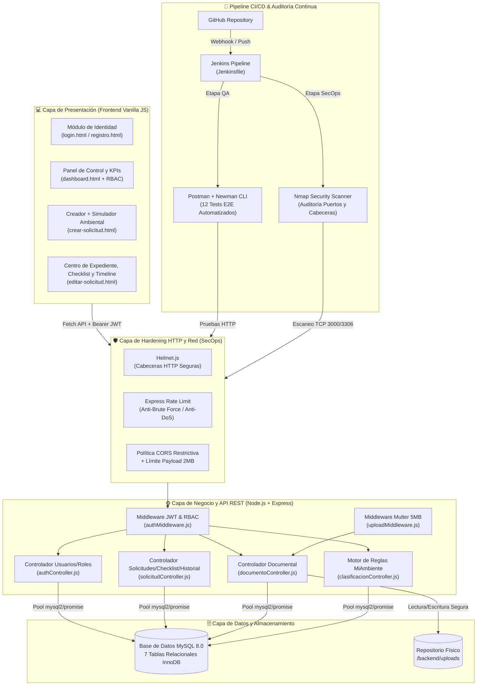

# 🌿 Sistema Digital de Gestión y Evaluación de Permisos Ambientales (MiAmbiente)

-100%25_COMPLETADO-1e8449?style=for-the-badge&logo=checkmarx&logoColor=white>)


> **Plataforma GovTech de Nueva Generación** diseñada para digitalizar, acelerar y transparentar el ciclo completo de evaluación de **Estudios de Impacto Ambiental (EsIA)** y permisos ambientales ante el Ministerio de Ambiente de Panamá (**MiAmbiente**), superando las limitaciones operativas y de experiencia de usuario de sistemas legados como **ESEVIA**.

---

## 1. 🎯 Visión y Propósito Ejecutivo

En la gestión ambiental tradicional bajo la **Ley 41 General de Ambiente de 1998**, los promotores de inversión, consultores ambientales y comunidades enfrentan un cuello de botella estructural: **los trámites de evaluación ambiental tardan entre 3 y 12 meses** debido al manejo de expedientes físicos, revisiones secuenciales desconectadas, falta de estandarización en los requisitos previos y opacidad sobre el estado real del trámite.

### ¿Cómo resuelve este problema nuestra plataforma?

1. **Desmaterialización y Ventanilla Única Digital:** Sustituye las carpetas físicas de cientos de folios por un expediente electrónico centralizado con validación instantánea de anexos técnicos (PDF, JPG, PNG hasta 5 MB).
2. **Pre-Clasificación Ambiental Automatizada:** Incorpora un motor algorítmico determinista basado en el **Decreto Ejecutivo 123** que evalúa 7 vectores de impacto (extensión territorial, afectación hídrica, cobertura forestal, emisiones, cercanía al SINAP, riesgo social y residuos peligrosos) para dictaminar en milisegundos si el proyecto corresponde a **Categoría I, Categoría II o Categoría III**.
3. **Rigor Técnico mediante Checklist Legal Interactivo:** Estandariza la revisión interdisciplinaria con una lista de verificación obligatoria y cálculo porcentual de cumplimiento en tiempo real antes de habilitar un dictamen aprobatorio.
4. **Transparencia y Trazabilidad Inmutable (Auditoría 360°):** Cada creación, modificación de campo, carga documental, observación técnica, subsanación y transición de estado queda registrada automáticamente en una bitácora de auditoría con sello de tiempo, autor, rol e IP de origen.

---

## 2. 🏆 Estado Actual del Proyecto (100% Completado — Sprints 0 al 7)

El núcleo funcional, técnico, de calidad (QA) y de seguridad (SecOps) planeado para la versión base del sistema ha sido **completado al 100%**, cubriendo **60 historias del Product Backlog (`HI-01` a `HT-24`)** equivalentes a **272 puntos de historia**.

| Sprint       | Enfoque Estratégico                                | Historias Cubiertas                                              | Módulos y Entregables Principales                                                                                                                                                                                                                                                            | Puntos |                                     Estado                                      |
| :----------- | :------------------------------------------------- | :--------------------------------------------------------------- | :------------------------------------------------------------------------------------------------------------------------------------------------------------------------------------------------------------------------------------------------------------------------------------------- | :----: | :-----------------------------------------------------------------------------: |
| **Sprint 0** | Fundación, Investigación y Arquitectura            | `HI-01` a `HI-07`, `HT-01` a `HT-03`, `HE-01` a `HE-03`, `HU-01` | Análisis del Caso 8 (Ley 41 de 1998), definición de actores, arquitectura cliente-servidor en Node.js, modelo relacional inicial, configuración de Git/variables `.env`, selección de herramientas (Postman, Nmap, Jenkins), mockups y Product Backlog priorizado.                           | **54** |  |
| **Sprint 1** | Identidad, Autenticación y Seguridad de Acceso     | `HU-02` a `HU-04`, `HT-04` a `HT-09`, `HE-04`                    | Registro e inicio de sesión de usuarios, encriptación de contraseñas con `bcryptjs`, emisión y validación de tokens `JWT`, protección de rutas con middleware, validaciones de entrada, pruebas iniciales en Postman y preparación de Jenkins CI.                                            | **45** |  |
| **Sprint 2** | Gestión Integral de Solicitudes Ambientales        | `HU-05` a `HU-08`, `HT-10`, `HT-11`, `HE-05`                     | CRUD completo de solicitudes de permisos ambientales (creación, consulta de detalle, edición condicional por estado y listado personalizado), persistencia en MySQL, pruebas API de solicitudes e integración del repositorio con Jenkins.                                                   | **42** |  |
| **Sprint 3** | Gestión Documental y Consulta de Estados           | `HU-09` a `HU-12`, `HT-12`, `HT-13`                              | Carga multipropósito de anexos técnicos con `multer`, validación estricta de MIME types (`PDF`, `JPG`, `PNG`) y límite de `5 MB`, descarga/visualización, eliminación controlada por estado, consulta de estado de solicitud y pruebas API documentales.                                     | **32** |  |
| **Sprint 4** | Evaluación Técnica y Flujo de Observaciones        | `HU-13` a `HU-17`, `HT-14`                                       | Bandeja especializada de solicitudes pendientes de revisión para evaluadores, emisión de observaciones técnicas/requerimientos legales, subsanación interactiva, actualización oficial de estados (`En Revisión`, `Con Observaciones`, `Aprobada`, `Rechazada`) y pruebas del flujo.         | **31** |  |
| **Sprint 5** | Checklist Normativo y Control de Acceso (RBAC)     | `HU-18` a `HU-22`, `HT-15`                                       | Inicialización automática de los 7 requisitos oficiales de MiAmbiente por expediente, marcado interactivo de cumplimiento, barra de progreso porcentual en vivo, administración de roles y middleware de autorización (`solicitante`, `evaluador`, `admin`).                                 | **34** |  |
| **Sprint 6** | Auditoría, Historial y Seguridad Inicial (Nmap)    | `HU-23`, `HT-16` a `HT-20`, `HE-06`                              | Tabla y motor de trazabilidad automática (`historial_solicitudes`), línea de tiempo de cambios de datos, estados y observaciones en frontend, scripts de escaneo de puertos/cabeceras con Nmap y reporte diagnóstico de vulnerabilidades iniciales.                                          | **29** |  |
| **Sprint 7** | Clasificación Ambiental, QA Integral y CI/CD Final | `HU-24` a `HU-26`, `HT-21` a `HT-24`, `HE-07`                    | Motor de reglas de pre-clasificación ambiental (Categorías I, II y III con puntaje de impacto), simulador en vivo, suite automatizada de 12 pruebas E2E en Postman/Newman, hardening en `server.js` (`helmet`, `express-rate-limit`, `CORS`), reporte final Nmap y `Jenkinsfile` productivo. | **42** |  |

---

## 3. 🏗️ Arquitectura y Stack Tecnológico

El sistema implementa una arquitectura modular desacoplada en capas, asegurando mantenibilidad, rapidez de respuesta y facilidad de auditoría tanto en el cliente como en el servidor.



### Estructura de Directorios del Proyecto

```text
sistema-permisos-ambientales-main/
├── backend/
│   ├── config/
│   │   └── database.js                  # Pool de conexiones MySQL con promesas
│   ├── controllers/
│   │   ├── authController.js            # Registro, Login, Perfil y Gestión de Roles
│   │   ├── clasificacionController.js   # Motor de Reglas Categorías I, II y III (Ley 41)
│   │   ├── documentoController.js       # Subida, descarga y borrado seguro de anexos
│   │   └── solicitudController.js       # CRUD Solicitudes, Revisión, Checklist e Historial
│   ├── middleware/
│   │   ├── authMiddleware.js            # Verificación JWT y autorización RBAC por rol
│   │   └── uploadMiddleware.js          # Filtro MIME (PDF/JPG/PNG) y límite de 5 MB
│   ├── routes/
│   │   ├── authRoutes.js                # Endpoints /api/auth/*
│   │   ├── clasificacionRoutes.js       # Endpoints /api/clasificacion/*
│   │   ├── documentoRoutes.js           # Endpoints /api/documentos/*
│   │   └── solicitudRoutes.js           # Endpoints /api/solicitudes/*
│   ├── uploads/                         # Almacenamiento local de anexos técnicos
│   ├── package.json                     # Dependencias y scripts de automatización
│   └── server.js                        # Punto de entrada Express + Hardening SecOps
├── database/
│   └── schema_consolidado_sprints_1_a_7.sql # Esquema relacional completo e idempotente
├── frontend/
│   ├── css/
│   │   └── styles.css                   # Hoja de estilos institucional MiAmbiente
│   ├── js/
│   │   ├── crear-solicitud.js           # Lógica de creación y simulación ambiental
│   │   ├── dashboard.js                 # Lógica de bandeja, filtros, KPIs y roles
│   │   ├── editar-solicitud.js          # Gestión integral del expediente y timeline
│   │   ├── login.js                     # Autenticación y almacenamiento JWT
│   │   └── registro.js                  # Alta de usuarios
│   ├── crear-solicitud.html
│   ├── dashboard.html
│   ├── editar-solicitud.html
│   ├── login.html
│   └── registro.html
├── postman/
│   └── sistema-permisos-ambientales.postman_collection.json # Suite automatizada Newman
├── seguridad/
│   ├── run-nmap-inicial.sh              # Script de auditoría Nmap para Linux/macOS
│   ├── run-nmap-inicial.bat             # Script de auditoría Nmap para Windows
│   ├── REPORTE_SEGURIDAD_SPRINT6.md     # Línea base de vulnerabilidades detectadas
│   └── REPORTE_SEGURIDAD_FINAL_SPRINT7.md # Certificación post-remediación SecOps
├── .env.example
├── .gitignore
├── Jenkinsfile                          # Pipeline declarativo CI/CD de 5 etapas
└── README.md
```

---

## 4. ⚡ Guía Rápida de Instalación y Despliegue (VS Code)

### Prerrequisitos

- **Node.js** `v18.0.0` o superior y **npm**.
- **MySQL Server** `8.0+` (o MariaDB vía XAMPP / Docker).
- **Git**, **Nmap** (opcional para auditoría local) y **Visual Studio Code**.

### Paso 1: Clonar el Repositorio y Abrir en VS Code

```bash
git clone [https://github.com/tu-organizacion/sistema-permisos-ambientales.git](https://github.com/tu-organizacion/sistema-permisos-ambientales.git)
cd sistema-permisos-ambientales
code .
```

### Paso 2: Inicializar la Base de Datos MySQL

Ejecuta el script consolidado desde tu terminal integrada de VS Code (`Ctrl + Ñ`) o desde MySQL Workbench:

```bash
mysql -u root -p < database/schema_consolidado_sprints_1_a_7.sql
```

### Paso 3: Configurar Variables de Entorno (`.env`)

Crea el archivo `backend/.env` tomando como plantilla `.env.example`:

```env
PORT=3000
NODE_ENV=development

# Credenciales de Base de Datos MySQL
DB_HOST=localhost
DB_PORT=3306
DB_USER=root
DB_PASSWORD=tu_password_mysql
DB_NAME=sistema_permisos_ambientales

# Seguridad JWT y Orígenes Permitidos
JWT_SECRET=miambiente_secreto_super_seguro_ley41_2026
JWT_EXPIRES_IN=8h
CORS_ORIGIN=http://localhost:3000
```

### Paso 4: Instalar Dependencias y Levantar el Servidor

El servidor Express sirve tanto la API REST (`/api/*`) como la aplicación Frontend estática en el mismo puerto para evitar conflictos de origen cruzado:

```bash
cd backend
npm install
npm run dev
```

- **Aplicación Web (Frontend):** [http://localhost:3000](http://localhost:3000)
- **Health Check de la API:** [http://localhost:3000/api/health](http://localhost:3000/api/health)

### Paso 5: Ejecutar Pruebas Automatizadas (Postman / Newman) y Auditoría Nmap

Con el servidor ejecutándose en una terminal, abre una segunda terminal en VS Code:

```bash
# 1. Ejecutar la suite completa de 12 pruebas integrales E2E (Sprint 7 - HT-21)
cd backend
npm run test:api

# 2. Verificar sintaxis de todos los módulos del backend (Linting etapa CI)
npm run lint

# 3. Ejecutar auditoría de puertos y cabeceras de seguridad con Nmap (Linux / Git Bash)
cd ..
chmod +x seguridad/run-nmap-inicial.sh
./seguridad/run-nmap-inicial.sh 127.0.0.1 3000 3306
```

_(En Windows PowerShell o CMD, ejecuta `.\seguridad\run-nmap-inicial.bat`)._

---

## 5. 🌟 Roadmap de Expansión (Sprints 8 al 10) — Rumbo al Estándar Mundial GovTech

Con el 100% de los requerimientos funcionales y de seguridad de los **Sprints 0 al 7** consolidados, el proyecto inicia su **Fase de Evolución Estratégica (Sprints 8, 9 y 10)** para establecer un nuevo estándar estético, ergonómico y funcional digno de reconocimiento internacional (**nivel Awwwards**):

- **🎨 Sprint 8 (Core UI/UX & Sistema de Diseño Bio-Inspirado):** Tokens de diseño dinámicos con Modo Oscuro/Claro de alto contraste, micro-interacciones reactivas, efectos _Glassmorphism_ sutiles, animaciones de entrada escalonadas (_Staggered Reveal_), _Skeleton Loaders_ y tarjetas KPI con anillos SVG animados.
- **⚡ Sprint 9 (Experiencia Guiada en Vivo & Visor Split-Screen):** Transformación del cuestionario ambiental en un **Asistente Interactivo (_Wizard_) con Medidor de Impacto en Tiempo Real (_Live Impact Meter_)**, zona de carga _Drag & Drop_ magnética con visor documental _Split-Screen_ (revisión de PDF y marcado de checklist lado a lado sin cambiar de pestaña) y línea de tiempo cinematográfica con comparador visual de cambios (_Diff Viewer_).
- **🗺️ Sprint 10 (Georreferenciación Interactiva, Command Palette & Pulido 60 FPS):** Integración de mapa interactivo (Leaflet/Mapbox) con capas de sensibilidad ambiental (áreas protegidas SINAP y cuencas hidrográficas), paleta de comandos ultrarrápida (`Ctrl + K`) para evaluadores, generador de **Dictamen Ambiental Editorial en PDF con código QR** verificable y certificación de rendimiento a `60 FPS` con accesibilidad **WCAG 2.1 AA/AAA**.
